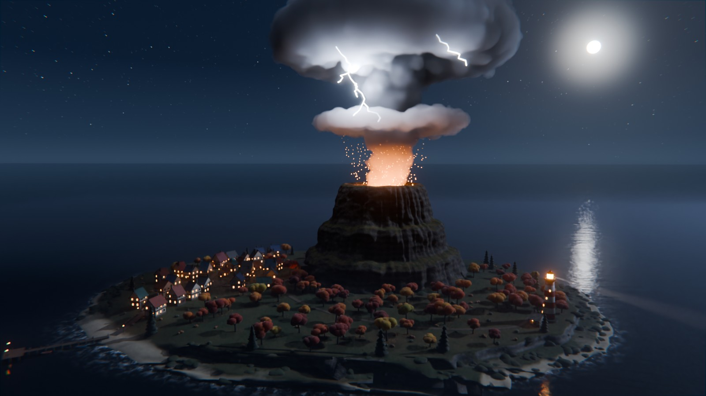
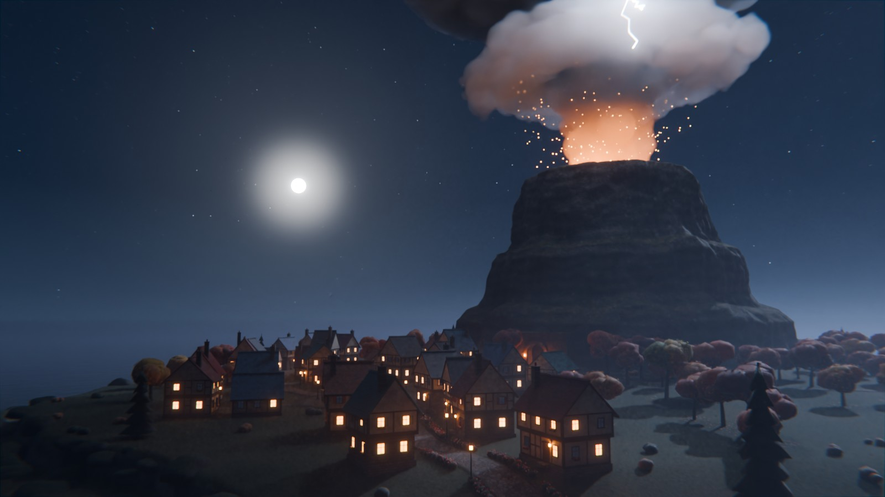
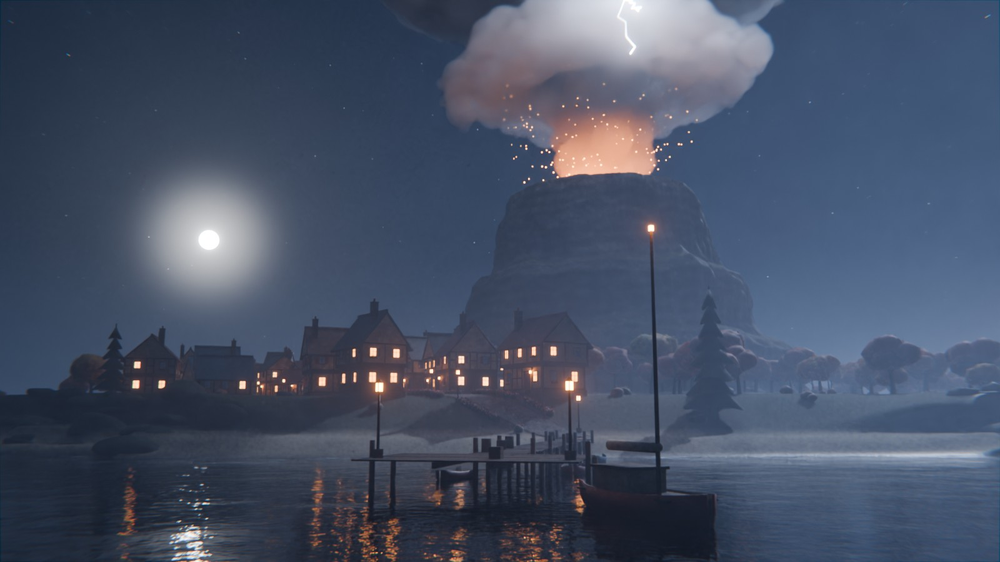
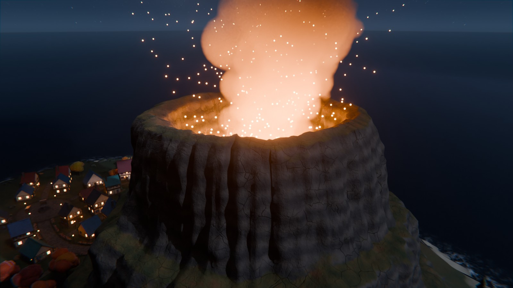

# First-person

One-file scene builders: paste a single script into the tool and it builds the whole scene.

| Script | Runs in | What it builds |
| --- | --- | --- |
| [`LuxuryVilla.lua`](LuxuryVilla.lua) | Roblox Studio command bar | A furnished two-storey villa with a pool, garden, carport and car |
| [`VolcanoIsland.py`](VolcanoIsland.py) | Blender 4.2 or newer | A foggy autumn island at night under an erupting volcano |

## Luxury Villa (Roblox Studio)

Paste one script into the Roblox Studio command bar to build a modern two-storey villa. It comes with a furnished interior, a pool terrace, a landscaped garden, a carport and a car. The build is about 3,600 parts, 140 lights and 11 doors that open in Play mode.


| Ground floor | Upper floor |
| --- | --- |
|  |  |

*These preview renders were made outside Roblox, so Roblox materials, lighting and textures will look different.*

### How to use

1. Open Roblox Studio and any place. The **Baseplate** template works best.
2. Open the command bar: **View** tab → **Command Bar**.
3. Open [`LuxuryVilla.lua`](LuxuryVilla.lua) and copy all of it. On GitHub, use the *Copy raw file* button.
4. Paste it into the command bar and press **Enter**.

The villa is built on the ground in front of your camera, with its front facing you. When it finishes, the villa is selected, so you can press **F** to zoom to it.

- **Undo:** `Ctrl+Z` removes the whole build in one step.
- **Rebuild:** running the script again replaces the previous `LuxuryVilla` in the same spot. Rename the old one first if you want to keep it.
- **Play:** walk up to any door, including the sliding glass doors, and press **E** to open or close it. You can sit on the sofas, chairs, stools and loungers.
- **Best look:** set **Lighting → Technology** to **Future**. For an evening glow, set `ClockTime` to about 18 in Lighting or in the script's `CONFIG`.

The lot is about 132 × 136 studs, so you need a fairly large flat area.

### What's included

**Ground floor**
- Entrance hall with a tall walnut pivot door, a console with a round mirror, and a round table with flowers
- Floating oak staircase on a steel spine, with glass balustrades and a skylight above
- Living room with a long stone fireplace (real fire), a wall-mounted TV, an L-shaped sofa, a coffee table, a reading chair, a grand piano and a library wall
- Open kitchen with a marble waterfall island, three bar stools, brass pendants, a sink, a cooktop and range hood, a fridge, an oven tower and open shelves
- Dining table for eight with place settings and a linear pendant light, plus a sideboard
- Guest WC and a small garden lounge with armchairs

**Upper floor**
- Landing lounge behind vertical cedar fins
- Home office with a desk, monitor, desk lamp and bookshelves
- Guest bedroom with a wardrobe alcove, a dresser and its own bathroom
- Reading nook overlooking the stairwell
- Main bedroom with pendant lights, a bench and a window seating corner
- Walk-in closet with hanging clothes, folded stacks and shoes
- Ensuite with a double vanity and backlit mirrors, a soaking tub and a walk-in rain shower
- Roof terrace with loungers, a bistro set and planters

**Outside**
- Cedar-clad upper floor that cantilevers over the entrance, plus solar panels on the roof
- Front garden with a stepping-stone path, garden lights and flower beds, and a boundary wall with lanterns, house number and mailbox
- Driveway with a carport and a car
- Timber deck with an outdoor lounge, pergola dining with string lights, and a barbecue
- Pool terrace with underwater lights, loungers, parasols and palm trees
- Fire pit lounge with festoon lights, plus trees, cypresses and uplights

### Settings

Change the `CONFIG` table at the top of the script before you paste it:

| Setting | Default | What it does |
| --- | --- | --- |
| `BuildInFrontOfCamera` | `true` | Build in front of the camera. Set to `false` to use `Position` and `RotationY` instead. |
| `Position` / `RotationY` | `0,0,0` / `0` | Lot centre and rotation in degrees, used when not building at the camera. |
| `ReplacePrevious` | `true` | Running again replaces the old villa, in the same spot. |
| `Lights` | `true` | Interior and garden lights. Set to `false` on slower computers. |
| `InteractiveDoors` | `true` | Adds a small Script so doors open with **E** in Play mode. |
| `ClockTime` | `nil` | For example `18.3` for a sunset. `nil` leaves your Lighting alone. |
| `HouseNumber` | `"27"` | Shown on the gate pillar and the licence plates. |

### Troubleshooting

- **Errors:** open **View → Output** to read what went wrong.
- **The command bar won't take the whole script:** create a **ModuleScript** in ServerStorage and paste the script into it. Then run `require(game.ServerStorage.ModuleScript)` in the command bar. A module only runs once per session, so to rebuild, paste the script into a fresh ModuleScript.
- **Doors don't open:** they only open in Play mode. Walk close to a door and press **E**.
- **Lag:** set `Lights = false`, or delete parts of the garden you don't need. Every room and every piece of furniture is its own model, so you can move or delete it easily.

## Volcano Island (Blender)

[`VolcanoIsland.py`](VolcanoIsland.py) builds a night scene in Blender from nothing but code: a stepped basalt volcano with a lava lake, a mushroom-shaped eruption cloud with lightning inside it, a half-timbered village, a harbour, a lighthouse and an autumn forest, all in moonlit fog on a dark sea. It needs no add-ons, images or downloads.



| Village | Harbour |
| --- | --- |
|  |  |



*Rendered with this script and its default settings in Blender 5.0 (Cycles, 1600×900, 64 samples).*

### How to use

1. Open Blender 4.2 or newer. It has been tested on 4.2 LTS and 5.0.
2. Open the **Scripting** workspace and click **New** in the text editor.
3. Open [`VolcanoIsland.py`](VolcanoIsland.py), copy all of it and paste it into the editor.
4. Click **Run Script** (or press `Alt+P`). Building takes about 5 to 10 seconds.
5. Press **F12** to render.

The script makes a new scene called **Volcano Island** and switches to it, so your other scenes are not touched. Running it again replaces that scene with a fresh build.

- **Viewport:** **Material Preview** is quick. **Rendered** view works too, but the cloud and fog are real volumes, so it is slow on a CPU.
- **Render time:** volumes are the expensive part. On a 4-core CPU a 1280×720 still with 48 samples took about 5 minutes. A GPU is much faster: the script turns on OptiX, CUDA, HIP, Metal or oneAPI when it finds one.
- **Other cameras:** select **Camera Village**, **Camera Harbour**, **Camera Aerial** or **Camera Crater** in the Outliner and press `Ctrl+Numpad 0`, or set `CAMERA` in `CONFIG`.
- **Animation:** press Play. The waves roll, the cloud churns, the lava flows, embers rise and the lighthouse beam sweeps round (240 frames by default).

### From the command line

```sh
blender -b -P VolcanoIsland.py -- render camera=Village samples=256 res=1920x1080 out=//island.png
blender -b -P VolcanoIsland.py -- animation out=//frames/island_
```

Options after `--`: `render`, `animation`, `camera=`, `samples=`, `res=WxH`, `engine=CYCLES|EEVEE`, `seed=`, `frames=`, `gpu=0|1` and `out=`.

### What's in the scene

**Volcano and sky**
- A stepped basalt butte, about 65 m tall, with tilted rock layers, gullies and columnar joints, and moss on its ledges
- A lava lake in the crater with moving glowing cracks, and crater walls lit by the heat
- An eruption column that rises into a ring of cloud and a rolling mushroom cap. It is a real volume, built from thousands of cauliflower puffs, dark with ash and lit orange from below
- Forked lightning inside the cloud, and embers that rise out of the crater
- Moonlit ground fog, a night sky with a moon, stars and a faint Milky Way

**Island and sea**
- Cliffs with rock ledges at their foot, a sandy harbour beach and a small cove
- A sea with animated waves and the moon's reflection, foam along the shore, and shallow water that shows the rocks below
- About 120 trees: autumn trees in reds, oranges and golds with fallen leaves under them, and dark pines near the cliffs
- Bushes on the lawns, and boulders along the coast and round the foot of the volcano

**Village and harbour**
- About 30 half-timbered houses, each one different: one or two floors, overhanging upper floors, stone ground floors, coloured tile roofs, chimneys, shutters, flower boxes, lit and dark windows, and a lamp by each door
- Cobbled streets that fade into the grass, a plaza with a fountain and two market stalls, street lanterns and flower hedges
- A wooden pier with lanterns, crates and barrels, four rowboats and a sailboat
- A striped lighthouse with a sweeping beam and a keeper's cottage, and a dirt path from the village out to it
- A mine entrance in the foot of the volcano with a stone arch, rails and torches

### Settings

Change the `CONFIG` dictionary at the top of the script before you run it:

| Setting | Default | What it does |
| --- | --- | --- |
| `SEED` | `7` | A different number gives a different coastline, volcano, village layout and forest. |
| `ENGINE` | `"CYCLES"` | `"EEVEE"` for a fast preview. Cycles looks much better with the volumes. |
| `USE_GPU` | `True` | Render on a GPU when Blender finds one. |
| `RESOLUTION` / `SAMPLES` | `1920×1080` / `128` | Render size and Cycles samples (denoised). |
| `CAMERA` | `"Hero"` | `"Hero"`, `"Village"`, `"Harbour"`, `"Aerial"` or `"Crater"`. |
| `TERRAIN_STEP` | `1.0` | Metres between terrain vertices. `2.0` builds faster and uses less memory. |
| `HOUSES` / `TREES` | `30` / `120` | How many houses and trees to place (fewer if there is no room). |
| `FOG` / `FOG_DENSITY` | `True` / `0.0045` | Volumetric ground fog and how thick it is. |
| `CLOUD`, `LIGHTNING`, `EMBERS` | `True` | The eruption cloud, its lightning and the embers. |
| `LIGHTHOUSE`, `HARBOUR` | `True` | The lighthouse and cottage, and the pier with its boats. |
| `ANIMATE` / `FRAMES` | `True` / `240` | Animated water, cloud, lava, embers and beam, and the frame range. |
| `RENDER_ON_FINISH` / `OUTPUT` | `False` / `"//volcano_island.png"` | Render a still as soon as the build finishes, and where to save it. |

### Troubleshooting

- **Errors:** open **Window → Toggle System Console** on Windows, or start Blender from a terminal, to read the message.
- **Renders are slow:** set `FOG = False` and lower `SAMPLES`. The cloud is the other big cost; `CLOUD = False` removes it.
- **Black or grey cloud in EEVEE:** volumes look best in Cycles. In EEVEE, raise **Render Properties → Volumes → Resolution** and **Steps**.
- **Out of memory:** raise `TERRAIN_STEP` to `1.5` or `2.0`, and lower `TREES`.
