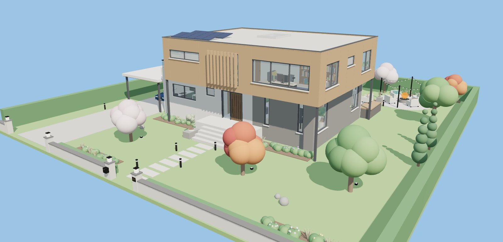
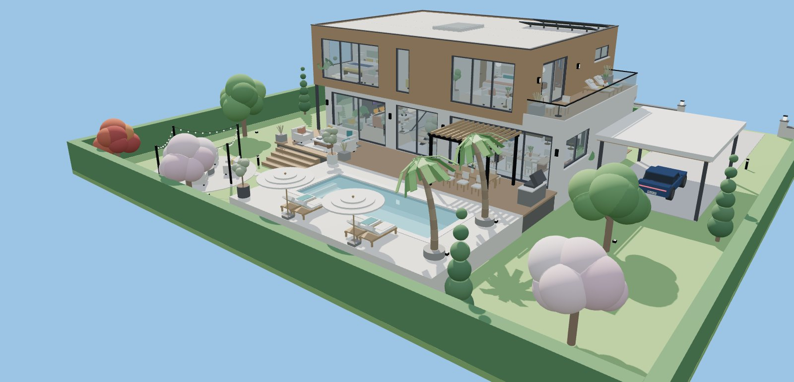
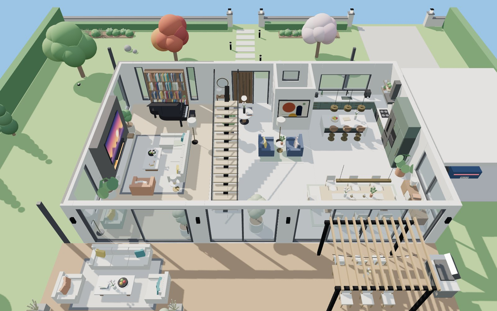
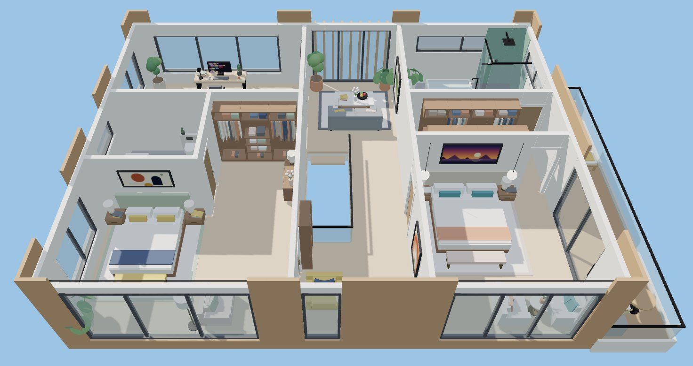

# Luxury Villa: Roblox Studio command bar script

Paste one script into the Roblox Studio command bar to build a modern two-storey villa. It comes with a furnished interior, a pool terrace, a landscaped garden, a carport and a car. The build is about 3,600 parts, 140 lights and 11 doors that open in Play mode.

| Ground floor | Upper floor |
| --- | --- |
|  |  |

*These preview renders were made outside Roblox, so Roblox materials, lighting and textures will look different.*

## How to use

1. Open Roblox Studio and any place. The **Baseplate** template works best.
2. Open the command bar: **View** tab → **Command Bar**.
3. Open [`LuxuryVilla.lua`](LuxuryVilla.lua) and copy all of it. On GitHub, use the *Copy raw file* button.
4. Paste it into the command bar and press **Enter**.

The villa is built on the ground in front of your camera, with its front facing you. When it finishes, the villa is selected, so you can press **F** to zoom to it.

- **Undo:** `Ctrl+Z` removes the whole build in one step.
- **Rebuild:** running the script again replaces the previous `LuxuryVilla` in the same spot. Rename the old one first if you want to keep it.
- **Play:** walk up to any door, including the sliding glass doors, and press **E** to open or close it. You can sit on the sofas, chairs, stools and loungers.
- **Best look:** set **Lighting → Technology** to **Future**. For an evening glow, set `ClockTime` to about 18 in Lighting or in the script's `CONFIG`.

The lot is about 132 × 136 studs, so you need a fairly large flat area.

## What's included

**Ground floor**
- Entrance hall with a tall walnut pivot door, a console with a round mirror, and a round table with flowers
- Floating oak staircase on a steel spine, with glass balustrades and a skylight above
- Living room with a long stone fireplace (real fire), a wall-mounted TV, an L-shaped sofa, a coffee table, a reading chair, a grand piano and a library wall
- Open kitchen with a marble waterfall island, three bar stools, brass pendants, a sink, a cooktop and range hood, a fridge, an oven tower and open shelves
- Dining table for eight with place settings and a linear pendant light, plus a sideboard
- Guest WC and a small garden lounge with armchairs

**Upper floor**
- Landing lounge behind vertical cedar fins
- Home office with a desk, monitor, desk lamp and bookshelves
- Guest bedroom with a wardrobe alcove, a dresser and its own bathroom
- Reading nook overlooking the stairwell
- Main bedroom with pendant lights, a bench and a window seating corner
- Walk-in closet with hanging clothes, folded stacks and shoes
- Ensuite with a double vanity and backlit mirrors, a soaking tub and a walk-in rain shower
- Roof terrace with loungers, a bistro set and planters

**Outside**
- Cedar-clad upper floor that cantilevers over the entrance, plus solar panels on the roof
- Front garden with a stepping-stone path, garden lights and flower beds, and a boundary wall with lanterns, house number and mailbox
- Driveway with a carport and a car
- Timber deck with an outdoor lounge, pergola dining with string lights, and a barbecue
- Pool terrace with underwater lights, loungers, parasols and palm trees
- Fire pit lounge with festoon lights, plus trees, cypresses and uplights

## Settings

Change the `CONFIG` table at the top of the script before you paste it:

| Setting | Default | What it does |
| --- | --- | --- |
| `BuildInFrontOfCamera` | `true` | Build in front of the camera. Set to `false` to use `Position` and `RotationY` instead. |
| `Position` / `RotationY` | `0,0,0` / `0` | Lot centre and rotation in degrees, used when not building at the camera. |
| `ReplacePrevious` | `true` | Running again replaces the old villa, in the same spot. |
| `Lights` | `true` | Interior and garden lights. Set to `false` on slower computers. |
| `InteractiveDoors` | `true` | Adds a small Script so doors open with **E** in Play mode. |
| `ClockTime` | `nil` | For example `18.3` for a sunset. `nil` leaves your Lighting alone. |
| `HouseNumber` | `"27"` | Shown on the gate pillar and the licence plates. |

## Troubleshooting

- **Errors:** open **View → Output** to read what went wrong.
- **The command bar won't take the whole script:** create a **ModuleScript** in ServerStorage and paste the script into it. Then run `require(game.ServerStorage.ModuleScript)` in the command bar. A module only runs once per session, so to rebuild, paste the script into a fresh ModuleScript.
- **Doors don't open:** they only open in Play mode. Walk close to a door and press **E**.
- **Lag:** set `Lights = false`, or delete parts of the garden you don't need. Every room and every piece of furniture is its own model, so you can move or delete it easily.
