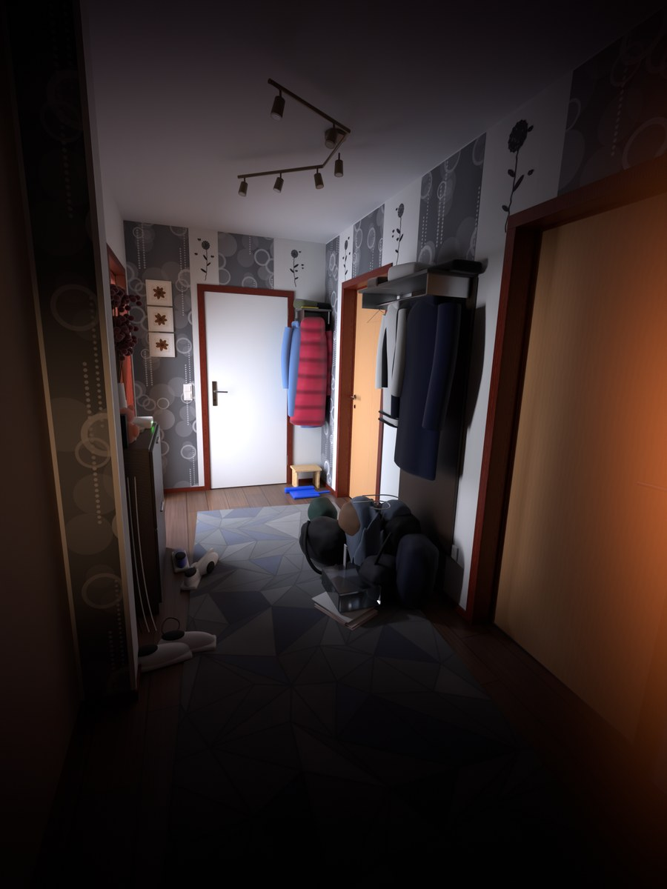

# First-person

Scripts that build a whole scene in one go:

| Script | Runs in | What it builds |
| --- | --- | --- |
| [`LuxuryVilla.lua`](LuxuryVilla.lua) | Roblox Studio command bar | A furnished two-storey villa with pool, garden and car |
| [`HallwayScene.py`](HallwayScene.py) | Blender 4.2 or newer | A dark apartment hallway, recreated from a phone photo |

## Luxury Villa (Roblox Studio)

Paste one script into the Roblox Studio command bar to build a modern two-storey villa. It comes with a furnished interior, a pool terrace, a landscaped garden, a carport and a car. The build is about 3,600 parts, 140 lights and 11 doors that open in Play mode.

| Ground floor | Upper floor |
| --- | --- |
|  |  |

*These preview renders were made outside Roblox, so Roblox materials, lighting and textures will look different.*

### How to use

1. Open Roblox Studio and any place. The **Baseplate** template works best.
2. Open the command bar: **View** tab → **Command Bar**.
3. Open [`LuxuryVilla.lua`](LuxuryVilla.lua) and copy all of it. On GitHub, use the *Copy raw file* button.
4. Paste it into the command bar and press **Enter**.

The villa is built on the ground in front of your camera, with its front facing you. When it finishes, the villa is selected, so you can press **F** to zoom to it.

- **Undo:** `Ctrl+Z` removes the whole build in one step.
- **Rebuild:** running the script again replaces the previous `LuxuryVilla` in the same spot. Rename the old one first if you want to keep it.
- **Play:** walk up to any door, including the sliding glass doors, and press **E** to open or close it. You can sit on the sofas, chairs, stools and loungers.
- **Best look:** set **Lighting → Technology** to **Future**. For an evening glow, set `ClockTime` to about 18 in Lighting or in the script's `CONFIG`.

The lot is about 132 × 136 studs, so you need a fairly large flat area.

### What's included

**Ground floor**
- Entrance hall with a tall walnut pivot door, a console with a round mirror, and a round table with flowers
- Floating oak staircase on a steel spine, with glass balustrades and a skylight above
- Living room with a long stone fireplace (real fire), a wall-mounted TV, an L-shaped sofa, a coffee table, a reading chair, a grand piano and a library wall
- Open kitchen with a marble waterfall island, three bar stools, brass pendants, a sink, a cooktop and range hood, a fridge, an oven tower and open shelves
- Dining table for eight with place settings and a linear pendant light, plus a sideboard
- Guest WC and a small garden lounge with armchairs

**Upper floor**
- Landing lounge behind vertical cedar fins
- Home office with a desk, monitor, desk lamp and bookshelves
- Guest bedroom with a wardrobe alcove, a dresser and its own bathroom
- Reading nook overlooking the stairwell
- Main bedroom with pendant lights, a bench and a window seating corner
- Walk-in closet with hanging clothes, folded stacks and shoes
- Ensuite with a double vanity and backlit mirrors, a soaking tub and a walk-in rain shower
- Roof terrace with loungers, a bistro set and planters

**Outside**
- Cedar-clad upper floor that cantilevers over the entrance, plus solar panels on the roof
- Front garden with a stepping-stone path, garden lights and flower beds, and a boundary wall with lanterns, house number and mailbox
- Driveway with a carport and a car
- Timber deck with an outdoor lounge, pergola dining with string lights, and a barbecue
- Pool terrace with underwater lights, loungers, parasols and palm trees
- Fire pit lounge with festoon lights, plus trees, cypresses and uplights

### Settings

Change the `CONFIG` table at the top of the script before you paste it:

| Setting | Default | What it does |
| --- | --- | --- |
| `BuildInFrontOfCamera` | `true` | Build in front of the camera. Set to `false` to use `Position` and `RotationY` instead. |
| `Position` / `RotationY` | `0,0,0` / `0` | Lot centre and rotation in degrees, used when not building at the camera. |
| `ReplacePrevious` | `true` | Running again replaces the old villa, in the same spot. |
| `Lights` | `true` | Interior and garden lights. Set to `false` on slower computers. |
| `InteractiveDoors` | `true` | Adds a small Script so doors open with **E** in Play mode. |
| `ClockTime` | `nil` | For example `18.3` for a sunset. `nil` leaves your Lighting alone. |
| `HouseNumber` | `"27"` | Shown on the gate pillar and the licence plates. |

### Troubleshooting

- **Errors:** open **View → Output** to read what went wrong.
- **The command bar won't take the whole script:** create a **ModuleScript** in ServerStorage and paste the script into it. Then run `require(game.ServerStorage.ModuleScript)` in the command bar. A module only runs once per session, so to rebuild, paste the script into a fresh ModuleScript.
- **Doors don't open:** they only open in Play mode. Walk close to a door and press **E**.
- **Lag:** set `Lights = false`, or delete parts of the garden you don't need. Every room and every piece of furniture is its own model, so you can move or delete it easily.

## Hallway (Blender)

One Python script recreates a phone photo of a dark apartment hallway in Blender. It sets up the room, every object, all textures, the lights, the camera and the render settings, so you only press **F12**.

### How to use

1. Open Blender 4.2 or newer. It is tested with 4.2 LTS and 5.2 LTS.
2. Switch to the **Scripting** workspace, press **Open**, choose [`HallwayScene.py`](HallwayScene.py) and press **Run Script** (▶). Building takes a few seconds.
3. Press **F12** to render. The render is 1500 × 2000 like the photo.

Running the script again clears the scene and builds it fresh. By default it deletes every object in the open scene, so start from a new file. Textures are generated by the script and packed into the `.blend` when you save.

Cycles at 256 samples takes a minute or two on a recent GPU. On a CPU it can take 15 minutes or more, so lower `samples` or `resolution_percentage` for a quick look.

To render from the command line, set `"render_on_build": True` in `CONFIG` and run `blender --background --python HallwayScene.py`. The image is saved next to the `.blend`, or in the current folder if nothing is saved yet.

### What's included

- **Room:** walls, ceiling and laminate floor measured from the photo. The hallway is about 1.9 m wide and 4.45 m long, with a 2.55 m ceiling, a wall pier on the left and a thicker wall on the right with deep door reveals.
- **Wallpaper:** grey strips with translucent circles, white rings and bead chains, plus flower-and-butterfly wall stickers on the white strips.
- **Doors:** a white entrance door with a long handle plate and hinges, two closed beech doors on the right, and an open kitchen door on the left. All have mahogany frames with trims, stops and lever handles.
- **Far wall:** three framed dried-flower pictures and a double light switch.
- **Coat racks:** a hat shelf by the entrance door with a red puffer jacket, a denim jacket and caps, and a coat panel on the right with a navy coat, a varsity jacket, caps and a wire hanger.
- **Floor:** a large faceted triangle rug, sneakers and slippers, a pile of backpacks and bags with a jacket thrown over it, magazines, a clear box, a step stool and a dustpan.
- **Left niche:** a slim shoe cabinet with a router (green LED), a teddy, figurines, a vase of dried hydrangeas and hanging cables.
- **Ceiling:** a 6-spot zig-zag track light, switched off like in the photo.

### How it matches the photo

- **Camera:** the position, rotation and focal length were solved from the photo's vanishing points. The lens is an ultra-wide phone lens, about 16 mm full-frame equivalent, held 1.46 m above the floor.
- **Layout:** each wall, door, shelf and coat was placed by projecting points from the photo back into 3D. Test renders were then overlaid on the photo and adjusted until the edges lined up.
- **Light:** the hallway light is off. Light comes from the lit kitchen through the open door on the left at the far end. That is why the entrance door is the brightest thing and the end nearest the camera is almost black. A small warm lamp off the right edge gives the near door its orange glow.
- **Phone look:** the brightness of each area was compared with the photo and tuned. The view transform is **Standard**, like a phone JPEG. A screen just in front of the lens, seen only by the camera, adds the phone's vignette, a slightly cool white balance and the orange light leak on the right edge.

The room, doors and big objects are measured. The clothes, bags and small things are close approximations.

### Settings

Change the `CONFIG` dictionary at the top of the script before you run it:

| Setting | Default | What it does |
| --- | --- | --- |
| `engine` | `"CYCLES"` | `"CYCLES"` matches the photo. `"EEVEE"` builds the same scene for a fast preview, but the lighting was tuned in Cycles. |
| `samples` | `256` | Cycles samples. The image is denoised, so 128 is fine for previews. |
| `use_gpu` | `True` | Use a GPU for Cycles when one is available, otherwise the CPU. |
| `denoise` | `True` | Denoise the Cycles render. |
| `resolution` / `resolution_percentage` | `(1500, 2000)` / `100` | Output size. Keep the 3:4 shape so the framing matches. |
| `exposure` | `0.0` | Extra exposure in stops. |
| `lens_fx` | `True` | The vignette and the orange light leak. Set to `False` for a clean render. |
| `texture_ppm` | `1.0` | Texture resolution. `0.5` builds faster and `2.0` is sharper. |
| `clear_scene` | `True` | Delete every object in the scene before building. |
| `render_on_build` | `False` | Render straight away and save to `output_path`. |
| `output_path` | `"//hallway_render.png"` | Where `render_on_build` saves the image. |
| `seed` | `27` | Random seed for the small variations, such as the flower heads. |
